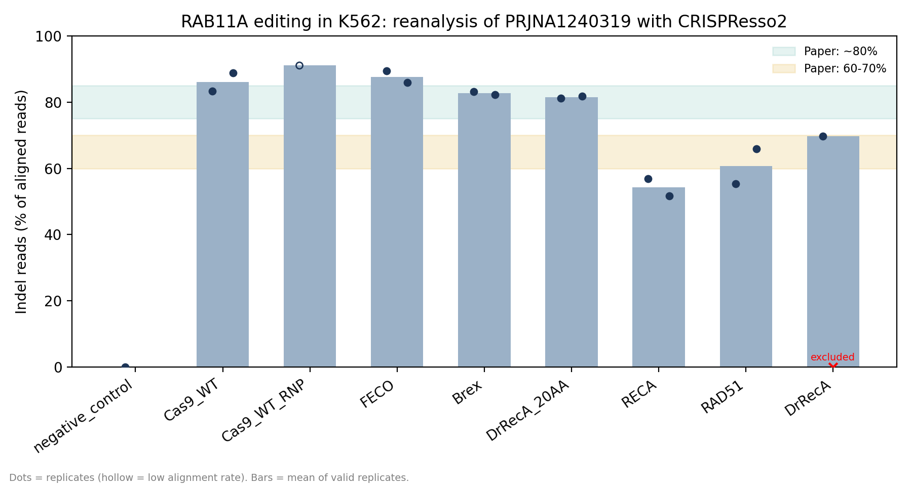

# Reanalysis of CRISPR-Cas9 editing outcomes at RAB11A (amplicon-seq, K562)

Reproducible pipeline that quantifies Cas9 editing efficiency from public amplicon-seq data and compares the result with the values reported in the original study.

## Question

Can I reproduce, with my own pipeline, the indel rates that Nam et al. (2025) report for wild-type Cas9 and Cas9 fusions at the RAB11A locus (their Supplementary Fig. S1)?

## Data

- Study: Nam et al., *Engineering tripartite gene editing machinery for highly efficient non-viral targeted genome integration*, Nature Communications 16:4569 (2025). doi:10.1038/s41467-025-59790-3
- Raw reads: NCBI SRA, BioProject PRJNA1240319 (SRP572254). 16 runs, Illumina paired-end amplicon-seq, K562 cells, RAB11A target.
- Conditions: negative control (NC), Cas9 WT (all-in-one plasmid, 2 replicates), Cas9 WT delivered as RNP (1), and six Cas9 fusions with 2 replicates each (FECO, Brex, DrRecA 20AA, RecA, RAD51, DrRecA).
- Guide and primer sequences were taken from the study's Supplementary Tables 2 and 3.

## Methods

1. Reads downloaded with SRA Toolkit (`fasterq-dump`).
2. Reference amplicon inferred from the NC sample: paired reads merged with fastp, merged reads delimited by the on-target primers, most frequent sequence taken as reference (275 bp). The guide and an NGG PAM were verified inside it.
3. Editing quantified with CRISPResso2 (`CRISPRessoBatch`) with default parameters. [CRISPResso2 2.3.4]
4. Indel % = (modified reads - reads with only substitutions) / aligned reads, so that substitutions, mostly sequencing/PCR errors, are not counted as editing.
5. Primer QC: for every sample, fraction of reads containing the on-target forward primer vs. the off-target forward primers (`scripts/qc_primers.sh`).

## Results



| Condition | Indels, mean of valid replicates (%) | n | Reported in the study |
|---|---|---|---|
| Negative control | 0.1 | 1 | not reported here |
| Cas9 WT | 86.0 | 2 | ~80% |
| FECO | 87.6 | 2 | ~80% |
| Brex | 82.7 | 2 | ~80% |
| DrRecA 20AA | 81.5 | 2 | ~80% |
| DrRecA (full length) | 69.7 | 1 | 60-70% |
| RAD51 | 60.7 | 2 | 60-70% |
| RecA (full length) | 54.3 | 2 | 60-70% |
| Cas9 WT, RNP | 91.0 (interpret with caution, see below) | 1 | positive control |

The pattern of the study is reproduced: Cas9 WT and short-motif fusions reach about 82-88% indels, while larger full-length fusions are lower (54-70%). Values differ by a few points from the approximate figures in the study. RecA is somewhat below the reported 60-70% range. The study gives approximate ranges only, so I did not test for differences.

Per-sample and per-condition tables: `results/indel_summary_per_sample.csv`, `results/indel_summary_per_condition.csv`.

## Limitations

- **SRR32811086 (labelled "AIO DrRecA 2") is not an on-target RAB11A amplicon.** 95% of its reads start with the forward primer of off-target site #2; only 29 of 59,766 reads contain the on-target primer. It was excluded, so DrRecA has a single valid replicate.
- **RNP_WT has a low alignment rate (31%).** Its reads are shorter (~157 nt vs ~250 nt), so R1 and R2 overlap by only ~39 nt, which probably lowers the merge rate. Its 91% indel value is based on the aligned reads only and is not reliable.
- Two replicates per condition (one for NC and RNP), so only descriptive statistics.
- One locus, one guide, K562 cells (a leukemia cell line, not iPSCs).
- Amplicon-seq only detects small indels inside the amplicon. Large deletions that remove a primer site, rearrangements and translocations are not captured.

## Reproduce

```
conda create -n crispresso2_env -c conda-forge -c bioconda crispresso2 sra-tools
conda activate crispresso2_env
# download FASTQ files listed in data/metadata/SRR_Acc_List.txt into data/fastq/
python scripts/infer_amplicon.py --r1 data/fastq/SRR32811088_1.fastq.gz --r2 data/fastq/SRR32811088_2.fastq.gz --out data/metadata/amplicon.txt
python scripts/make_batch.py --samples data/metadata/samples.csv --amplicon data/metadata/amplicon.txt --out data/metadata/batch.tsv
CRISPRessoBatch --batch_settings data/metadata/batch.tsv -o results -n rab11a -p 4
python scripts/summarize.py --quant results/CRISPRessoBatch_on_rab11a/CRISPRessoBatch_quantification_of_editing_frequency.txt --samples data/metadata/samples.csv --outdir results
bash scripts/qc_primers.sh data/fastq results/primer_qc.csv
```

## References

- Nam H. et al. Nat Commun 16:4569 (2025).
- Clement K. et al. CRISPResso2 provides accurate and rapid genome editing sequence analysis. Nat Biotechnol 37:224-226 (2019).
